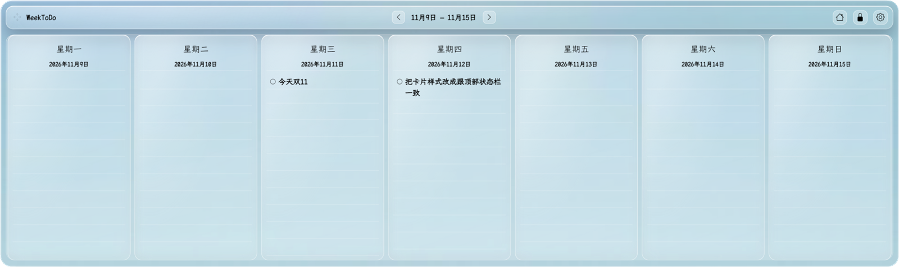
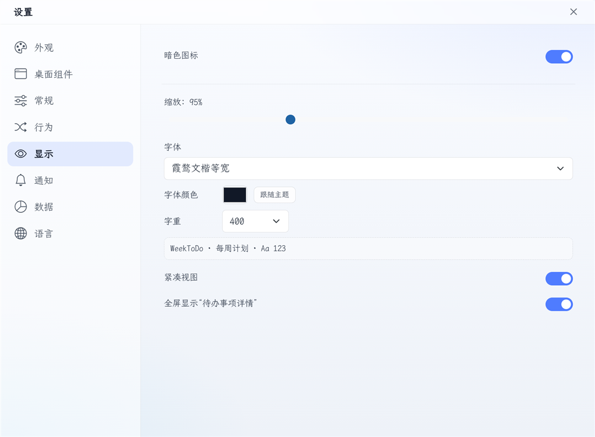

**English** | [简体中文](README.md)

# WeekToDo | FOSS Minimalist Weekly Planner

---


[](https://vuejs.org/)

WeekToDo is a free minimalist weekly planner app focused on privacy. Schedule your tasks and projects with to-do lists and a calendar.

> This fork turns the weekly view into a widget that lives on the Windows desktop, and adds liquid-glass themes, system-font selection, and several desktop-oriented layout improvements. It is Windows-only and is based on the [original WeekToDo](https://github.com/manuelernestog/weektodo).

[](https://github.com/11HAN/weektodo/releases/latest)

## Screenshots

### Windows desktop widget

<p align="center">
  
</p>

### Settings

<p align="center">
  
</p>

## Features

- Interactive Windows desktop widget (attached to the desktop layer and still visible after Win+D)
- Light/dark mode toggle
- Custom To-do Lists
- Drag and Drop
- Liquid-glass, frosted, acrylic and paper desktop themes
- System font family, font colour and font weight selection
- Live config sync between the widget and settings windows
- Multi-language
- Sub-tasks
- Markdown Support
- Customizable user interface
- Local Storage
- Task Colors
- Task Time
- Recurring Tasks
- Notifications and reminders

## Roadmap

- Touch mode
- Multi-monitor support
- Sync across devices
- Workspaces

## Sponsors

WeekToDo is an GPL-licensed open source project with its ongoing development made possible entirely by users support and sponsors. If you'd like to join them, please consider [ sponsoring WeekToDo's development](https://weektodo.me/sponsor-us/) or [make the donation](https://weektodo.me/support-us/) you can.

<p align="center">
  <h3 align="center">Diamond Sponsors</h3>
</p>

<p align="center">
  <a target="_blank" href="https://password.link">
  
  </a>
</p>

<p align="center">
  <h3 align="center">Silver Sponsors</h3>
</p>

<p align="center">
  <a target="_blank" href="https://www.snapclear.app/">
    
  </a>
  <a target="_blank" href="https://chrome.google.com/webstore/detail/easyfiller-automatic-form/oaphggcbnpminjffkjgldfepehcdjndp?hl=es&authuser=0">
    
  </a>
</p>

## Desktop Widget (Windows)

On Windows, WeekToDo runs a compact weekly view directly on the desktop. It is attached to the shell's desktop tree (`SHELLDLL_DefView`) rather than being faked with an always-on-top or "lowered" window, so it stays below normal application windows and survives Win+D. It is placed above the desktop icon list inside its own rectangle so mouse clicks, text input and task drag and drop continue to work.

The app starts as the desktop widget only; the old normal WeekToDo window is no longer created. Use the tray menu to open settings, toggle the widget, or quit.

- Drag the widget by its header when it is unlocked. The header is a pure drag handle; the top edge and top corners are not resize zones.
- The padlock button locks/unlocks position and resizing. While locked, the weekly panes, tasks, and buttons still receive clicks normally.
- Resize from the left/right edges, the bottom edge, and the two bottom corners. Position and size are remembered.
- The widget always shows exactly seven days, starting on Monday or Sunday as configured under Settings -> Desktop widget.
- Add tasks by clicking the empty area below a day's tasks or from the three-dot menu. There is no persistent new-task button in the desktop widget.
- While a text field is focused the widget temporarily becomes a normal top-level window so the IME candidate window follows the caret; it returns to the desktop layer when the field loses focus.
- Each day's task list scrolls with the mouse wheel while the outer card stays fixed. Scrollbars are hidden, and the day header and input area stay in place. The widget can be reduced to 320 DIP height.
- The gear button and the tray Settings entry open a separate, frameless, resizeable settings window. Its top "设置" bar is draggable and contains the close button.
- Appearance includes frosted, acrylic, paper, liquid-glass clear, liquid-glass white, and liquid-glass dark themes, plus a live opacity slider. The liquid-glass themes use SVG refraction on the outer card, header, and day columns together with CSS specular highlights.
- Display settings can pick an installed Windows font family, a custom font colour, and a font weight from 300 to 1000. Settings are saved and synced live across the widget and settings windows.
- Wrapped task text uses a hanging indent, and the hover details card stays opaque for readability.
- The palette-style button in older builds has been replaced by the gear settings button.

The widget samples the desktop wallpaper through `PrintWindow(Progman)` and blurs it behind the card, so its colours follow the actual wallpaper while the Electron window stays opaque and interactive. The widget is disabled automatically if the Windows desktop layer cannot be attached; the app does not fall back to a normal top-level window.

## Download and Installation

### Windows

Download the latest installer from [Releases](https://github.com/11HAN/weektodo/releases/latest):

- `WeekToDo Setup 2.2.12.exe` (x64)

After installation, the app starts directly as the desktop widget. Use the tray menu to open settings, toggle the widget, or quit.

> The installer is not code-signed, so Windows SmartScreen may warn you. Choose "More info" -> "Run anyway" to continue.

### Requirements

- Windows 10 / 11 (x64)
- The installer bundles Electron, so no separate runtime is required

There are currently no macOS or Linux builds.

## Build From Source

### Requirements

- Windows 10 / 11
- [Node.js](https://nodejs.org/) (tested with Node 24; other versions may need `yarn install --ignore-engines`)
- [Yarn](https://yarnpkg.com/)
- Git

### Steps

```powershell
git clone https://github.com/11HAN/weektodo
cd weektodo
yarn install --ignore-engines
yarn lint

$env:NODE_OPTIONS='--openssl-legacy-provider'
yarn electron:build
```

Output:

- Installer: `dist_electron\WeekToDo Setup 2.2.12.exe`
- Unpacked build: `dist_electron\win-unpacked\WeekToDo.exe`

Use `yarn electron:build --dir` to produce only the unpacked build. Quit any running WeekToDo instance before packaging.

## References and Credits

- [manuelernestog/weektodo](https://github.com/manuelernestog/weektodo) — the original WeekToDo project this fork is based on.
- [bubu-LZY/desktop_todo_Calendar](https://github.com/bubu-LZY/desktop_todo_Calendar) — a desktop todo calendar that served as a reference for the Mica / Acrylic glass look and desktop-embedded interaction.
- [archisvaze/liquid-glass](https://github.com/archisvaze/liquid-glass) — the MIT-licensed reference implementation for liquid-glass edge refraction. The original notice is kept in `src/helpers/liquidGlass.js`.

## Contributing

WeekToDo is open-source. Pull requests and contributions are welcome! There are two ways to contribute: grab a [bug report](https://github.com/manuelernestog/weektodo/issues?q=is%3Aopen+is%3Aissue+label%3Abug) or [feature suggestion](https://github.com/manuelernestog/weektodo/issues?q=is%3Aissue+is%3Aopen+label%3Afeature) that has been marked `accepted` and dig in.

Read [Contributing.md](/CONTRIBUTING.md) for more information.

### Translations

Currently the system is developed in multiple languages, you can send me a correction of any error or you can add your language if it's not available.

You can find the base file with all the used words in english [here](src/assets/languages/en.json).

For add a new language Fork the repo and create a Pull Request creating a new file based on `src/assets/languages/en.json` and name the file according to the [language code](https://gist.github.com/Josantonius/b455e315bc7f790d14b136d61d9ae469).

If this is too difficult, you can download this [file](src/assets/languages/en.json), translate it and send the file to contact@weektodo.me

## License

This fork is distributed under the GNU General Public License v3. See
[LICENSE](LICENSE). The original WeekToDo project is by
[Manuel Ernesto Garcia](https://manuelernestogr.bio.link/).

The liquid-glass refraction code was adapted from Archis Vaze's MIT-licensed
[liquid-glass](https://github.com/archisvaze/liquid-glass) demo. The original
MIT notice is kept in `src/helpers/liquidGlass.js`.

## Author

- [Manuel Ernesto Garcia](https://manuelernestogr.bio.link/)

## Contributors

- Logo Rebranding by [hallgraph](https://twitter.com/hallgraph)
- [Translators](https://weektodo.me/about/)

<a href="https://github.com/manuelernestog/weektodo/graphs/contributors">
  
</a>

Made with [contrib.rocks](https://contrib.rocks).
