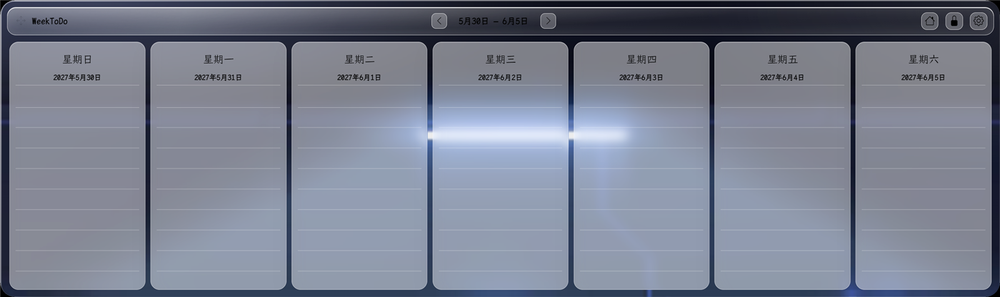
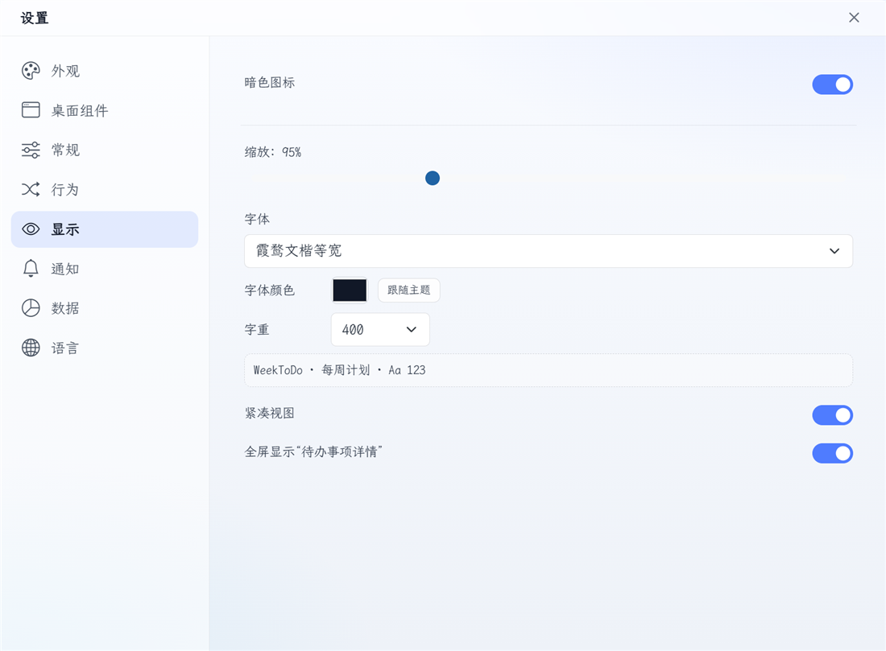

# WeekToDo | FOSS Minimalist Weekly Planner
---
 
[](https://vuejs.org/)

WeekToDo is a free minimalist weekly planner app focused on privacy. Schedule your tasks and projects with to do lists and a calendar. Available for Windows, Mac, Linux or online.

> This fork adds an interactive Windows desktop widget, liquid-glass themes, system-font selection, and several desktop-oriented layout improvements to the original WeekToDo app.


## Screenshots

### Windows desktop widget

<p align="center">
  
</p>

<p align="center">
  <sub>Empty future week shown to avoid exposing personal task data.</sub>
</p>

### Settings

<p align="center">
  
</p>

## Features

- Cross platform
- Light/dark mode toggle
- Custom To-do Lists
- Drag and Drop
- Optional interactive Windows desktop widget
- Liquid-glass, frosted, acrylic and paper desktop themes
- System font family, font colour and font weight selection
- Live config sync between the widget and settings windows
- Multi-language
- Sub-tasks
- Markdown Support
- Customizable user interface
- Local Storage
- Task Colors
- Task Time
- Recurring Tasks
- Notifications and reminders

## Roadmap

- Touch mode
- Mobile Version
- Sync across devices
- Workspaces

## Sponsors

WeekToDo is an GPL-licensed open source project with its ongoing development made possible entirely by users support and sponsors. If you'd like to join them, please consider [ sponsoring WeekToDo's development](https://weektodo.me/sponsor-us/) or [make the donation](https://weektodo.me/support-us/) you can.

<p align="center">
  <h3 align="center">Diamond Sponsors</h3>
</p>

<p align="center">
  <a target="_blank" href="https://password.link">
  
  </a>
</p>

<p align="center">
  <h3 align="center">Silver Sponsors</h3>
</p>

<p align="center">
  <a target="_blank" href="https://www.snapclear.app/">
    
  </a>
  <a target="_blank" href="https://chrome.google.com/webstore/detail/easyfiller-automatic-form/oaphggcbnpminjffkjgldfepehcdjndp?hl=es&authuser=0">
    
  </a>
</p>

  
## Desktop Widget (Windows)

On Windows, WeekToDo can run a second, compact weekly view directly on the
desktop. It is attached to the shell's desktop tree (`SHELLDLL_DefView`) rather
than being faked with an always-on-top or "lowered" window, so it stays below
normal application windows and survives Win+D. It is placed above the desktop
icon list inside its own rectangle so mouse clicks, text input and task drag and
drop continue to work.

On Windows the app starts as the desktop widget only; the old normal WeekToDo
window is no longer created. Use the tray menu to open settings, toggle the
widget, or quit.

- Drag the widget by its header when it is unlocked. The header is a pure drag
  handle; the top edge and top corners are not resize zones.
- The padlock button locks/unlocks position and resizing. While locked, the
  weekly panes, tasks, and buttons still receive clicks normally.
- Resize from the left/right edges, the bottom edge, and the two bottom corners.
  Position and size are remembered.
- The widget always shows exactly seven days, starting on Monday or Sunday as
  configured under Settings -> Desktop widget.
- Add tasks by clicking the empty area below a day's tasks or from the three-dot
  menu. There is no persistent new-task button in the desktop widget.
- Each day's task list scrolls with the mouse wheel while the outer card stays
  fixed. Scrollbars are hidden, and the day header and input area stay in place.
  The widget can be reduced to 320 DIP height.
- The gear button and the tray Settings entry open a separate, frameless,
  resizeable settings window. Its top "设置" bar is draggable and contains the
  close button.
- Appearance includes frosted, acrylic, paper, liquid-glass clear, liquid-glass
  white, and liquid-glass dark themes, plus a live opacity slider. The
  liquid-glass themes use SVG refraction on the outer card, header, and day
  columns together with CSS specular highlights.
- Display settings can pick an installed Windows font family, a custom font
  colour, and a font weight from 300 to 1000. Settings are saved and synced live
  across the widget and settings windows.
- Wrapped task text uses a hanging indent, and the hover details card stays
  opaque for readability.
- The palette-style button in older builds has been replaced by the gear
  settings button.

The widget samples the desktop wallpaper through `PrintWindow(Progman)` and
blurs it behind the card, so its colours follow the actual wallpaper while the
Electron window stays opaque and interactive. The widget is disabled
automatically if the Windows desktop layer cannot be attached; the app does not
fall back to a normal top-level window.

## Installation

### Download installer 

[Windows / Linux / macOS](https://github.com/zuntek/weektodoweb/releases/latest
) 

### External Stores

#### Windows 

[Uptodown](https://weektodo.uptodown.com/windows)

#### macOS 

[Macupdate](https://www.macupdate.com/app/mac/63506/weektodo)

#### Linux 

Snapd can be installed from the command line:

```bash
sudo apt update
sudo apt install snapd
```
To install WeekToDo, simply use the following command:
```bash
sudo snap install weektodo
```    

## Build and Run From Source

If you want to understand how WeekToDo works or want to debug an issue, you'll want to get the source, build it, and run it locally.

### Installing Prerequisites

You'll need git, a recent version of [Node.JS](https://nodejs.org/en/) (currently v16.X is recommended), [Yarn](https://yarnpkg.com/) and [Electron](https://www.electronjs.org/).

```
git clone https://github.com/11HAN/weektodo
cd weektodo
yarn install
yarn run serve // to run web version
yarn run electron:serve // to run native version
```

Upstream project: [manuelernestog/weektodo](https://github.com/manuelernestog/weektodo).

### Docker

 To run the development web version use `docker-compose up`

## Contributing

You can support this project in several ways:

### Donate

https://weektodo.me/support-us

### Share

- [Facebook](https://www.facebook.com/sharer/sharer.php?u=https%3A%2F%2Fweektodo.me%2F)
- [Twitter](https://twitter.com/intent/tweet?url=https%3A%2F%2Fweektodo.me%2F&text=)
- [Linkedin](https://www.linkedin.com/shareArticle?mini=true&url=https%3A%2F%2Fweektodo.me%2F&title=)

### Rate the app

- [ProductHunt](https://www.producthunt.com/posts/weektodo)
- [AlternativeTo](https://alternativeto.net/software/weektodo/about/)
- [SassHub](https://www.saashub.com/weektodo-reviews/new)

### Translations

Currently the system is developed in multiple languages, you can send me a correction of any error or you can add your language if it's not available.

You can find the base file with all the used words in english [here](src/assets/languages/en.json/)

For add a new language Fork the repo and create a Pull Request creating a new file of the `translations/en.json` and name he file acording the [language code](https://gist.github.com/Josantonius/b455e315bc7f790d14b136d61d9ae469). 

If this is to dificult, you can donwload this [file](src/assets/languages/en.json/), translate it and send the file to the email contact@weektodo.me
 
## Contributing

Weektodo is open-source. Pull requests and contributions are welcome! There are three ways to contribute: grab a [bug report](https://github.com/manuelernestog/issues?q=is%3Aopen+is%3Aissue+label%3Abug) or [feature suggestion](https://github.com/manuelernestog/issues?q=is%3Aissue+is%3Aopen+label%3Afeature) that has been marked `accepted` and dig in.

Read [Contributing.md](/CONTRIBUTING.md) for more information.

## License

This fork is distributed under the GNU General Public License v3. See
[LICENSE](LICENSE). The original WeekToDo project is by
[Manuel Ernesto Garcia](https://manuelernestogr.bio.link/).

The liquid-glass refraction code was adapted from Archis Vaze's MIT-licensed
[liquid-glass](https://github.com/archisvaze/liquid-glass) demo. The original
MIT notice is kept in `src/helpers/liquidGlass.js`.

## Author

- [Manuel Ernesto Garcia](https://manuelernestogr.bio.link/)

## Contributors

- Logo Rebranding by [hallgraph](https://twitter.com/hallgraph)
- [Translators](https://weektodo.me/about/)

<a href="https://github.com/manuelernestog/weektodo/graphs/contributors">
  
</a>


Made with [contrib.rocks](https://contrib.rocks).

  
